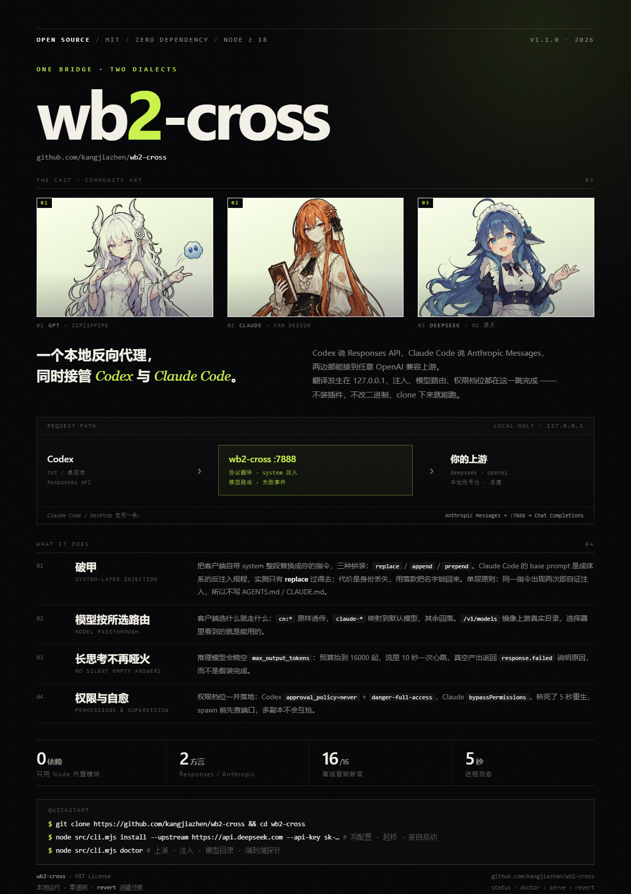

# 宣传图 / Promo sheet



| 文件 | 说明 |
| --- | --- |
| `poster.html` | 源文件（1240×1754，A3 竖版比例，纯 HTML/CSS，只依赖同目录 `assets/` 三张立绘） |
| `poster.png` | 1240×1754 位图，贴群 / 挂 README 用 |
| `poster.pdf` | 打印用单页 PDF |
| `assets/gpt-bust.png` | GPT 娘（白发龙娘）上半身 |
| `assets/claude-bust.png` | Claude 娘（向日葵与书）上半身 |
| `assets/dsh-bust.png` | DeepSeek 鲸鱼女仆上半身 |

重新渲染（Windows，装有 Edge；`--allow-file-access-from-files` 不能省，否则本地图不加载）：

```powershell
msedge --headless=new --disable-gpu --hide-scrollbars --allow-file-access-from-files `
  --virtual-time-budget=9000 --window-size=1240,1754 --screenshot=poster.png poster.html
msedge --headless=new --disable-gpu --hide-scrollbars --allow-file-access-from-files `
  --no-pdf-header-footer --virtual-time-budget=9000 --print-to-pdf=poster.pdf poster.html
```

排版坑（踩过的）：headless Edge 里 **CJK 段落不要用行内 `<b>` 包中日韩字**，
字形步进会算错、出现两个字叠在一起的鬼影；要强调就用颜色/字号，或把强调段单独成行。
Latin 与代码片段用 `<span class="mono">` 没问题。

## 角色授权（与代码分开）

三张立绘都是社区同人形象，**不是** OpenAI / Anthropic / DeepSeek 官方素材：

| 角色 | 形象来源 | 本期图片 |
| --- | --- | --- |
| GPT 娘（白发龙娘，ZipZipPipe 设定） | ZipZipPipe（B 站原帖） | GenderSwapAI 生成二创参考 |
| Claude 娘（橙发、向日葵发饰、抱书） | 社区同人设定 | GenderSwapAI 生成二创参考 |
| 鲸鱼娘（原创 OC「溟月」） | 上善无形；DeepSeek 元素二创 ZipZipPipe；修复 QYQCAMIAO | [fornarwhal/deepseek-whale-girl-icon](https://github.com/fornarwhal/deepseek-whale-girl-icon) |

- 角色档案与图源：<https://genderswapai.com/zh-CN/ai-gijinka/gpt>、<https://genderswapai.com/zh-CN/ai-gijinka/claude>
- 鲸鱼娘原仓库授权：**CC BY-NC-SA 4.0**（署名、非商用、相同方式共享）

因此本目录下的 `poster.*` 与 `assets/` 按 **CC BY-NC-SA 4.0** 授权，仅用于项目介绍、不含商业用途；
仓库其余代码仍为 MIT。若要商用或再分发海报，请自行替换 `poster.html` 里三处 ``。
